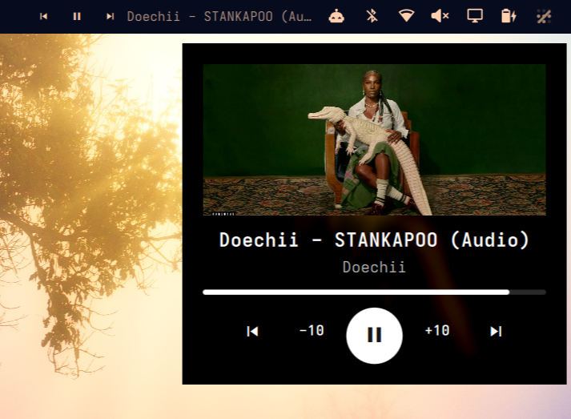
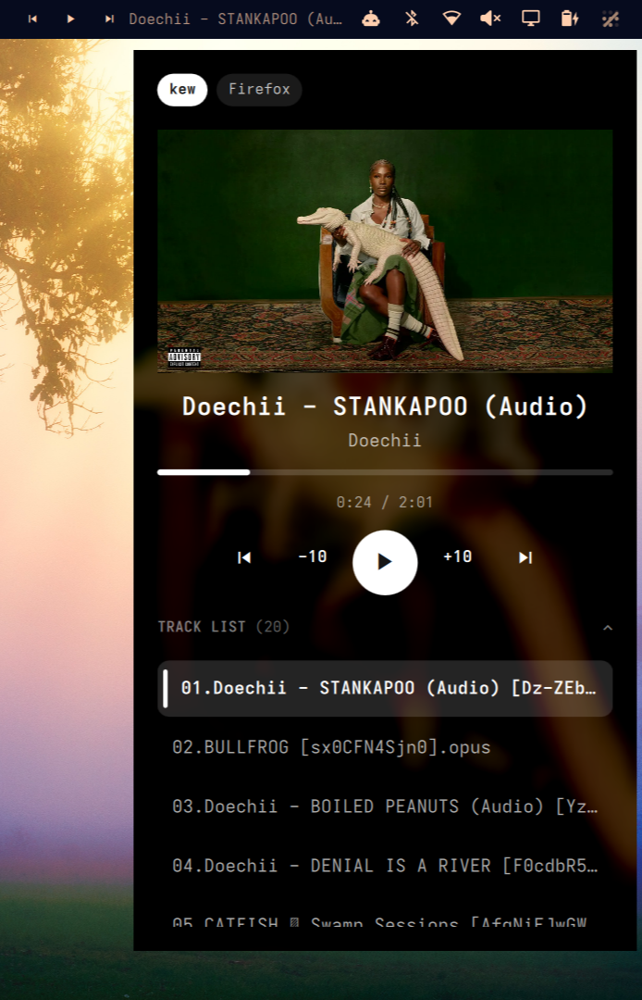
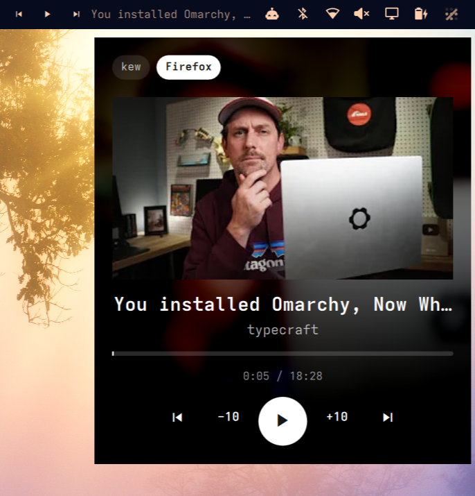

# Now Playing for Omarchy [](https://github.com/tcballard/omarchy-badges)

An artwork-first media widget for the Omarchy bar. Keep the essentials in the
bar, hover over the song title for a quick look, or click the preview to pin
full controls. It works with [**kew**](https://www.kewplayer.com/), mpv, and other players that expose MPRIS.


## A preview that stays out of the way

Hovering over the title opens a small artwork-led preview. Moving away closes
it; clicking the preview pins the larger player until you click outside or
press Escape.



The pinned view adds source switching, track position, seeking, and a
collapsible **Track List**. The list starts closed and can include both
previous and upcoming tracks.



## Made for kew, without being tied to it

[kew](https://www.kewplayer.com/) exposes MPRIS TrackList, so you can browse its current list and jump
directly to a track from the popup. If kew and another player are running,
source chips let you choose which one this widget controls. Separate
instances of the same player are listed individually.

Other MPRIS players still get the artwork, metadata, and transport controls
they support. A browser tab, for example, can be selected even if it does not
offer a track list:



| Player | Playback and seeking | Track list |
| --- | --- | --- |
| **kew** | MPRIS controls | MPRIS TrackList, including jump-to-track |
| **mpv** | MPRIS controls when enabled | Its playlist through the optional mpv IPC socket |
| **Other MPRIS players** | Whatever capabilities they expose | Shown only if they expose TrackList |

The five popup controls are **previous · back 10s · play/pause · forward 10s ·
next**. Unsupported actions are disabled, not sent blindly. The progress bar
is clickable only when the selected player supports seeking.

Artwork fills the preview and softly colors its background. 
If there is no artwork, a media placeholder appears and the background returns to the current Omarchy theme. 
Local cover files next to a song are also considered when the player does not supply art.

## Install

Requires Omarchy Quattro with its Quickshell plugin system and at least one
MPRIS-capable player. There are **no extra packages to install** on Omarchy:
the plugin uses Quickshell and the system's existing `busctl` for TrackList.
It does not need Python, Rust, `playerctl`, or a separately installed backend.

From this checkout:

```sh
omarchy plugin add "$PWD" --enable
```

After the repository is published at the URL below, the same install is:

```sh
omarchy plugin add https://github.com/superb-striker/media-controller-plugin.git --enable
```

The widget is placed in the right bar section by default, which can be changed in `~/.config/omarchy/shell.json`

Bar text defaults to one logical pixel smaller than Omarchy's body text and
follows theme changes automatically. Popup text uses shared theme sizes. Playback buttons
follow the bar height. Automatic title width starts at 150 logical pixels for
a 12px body font and 26px bar, scales with the font and bar size, and is capped
at 10% of the host bar window width. The cap shrinks as display scaling reduces
the available logical width. Long titles are elided. Popup spacing and controls scale with the font and bar size.
Qt handles monitor scaling, so no per-monitor scale setting is required.

The optional `width` and `fontSize` settings default to `0` (automatic). Positive
values override the title width and bar text size in logical pixels. If an older
configuration explicitly sets `180`/`12` or other values, remove those settings
or set them to `0` to follow the theme. Popup text uses the theme's caption, body,
and heading sizes.


## Optional mpv playlist support

mpv is included with Omarchy. Its normal controls use MPRIS; to expose mpv's
playlist in the popup, add these lines to `~/.config/mpv/mpv.conf` (or include
the bundled [example](config/mpv.conf)):

```ini
input-ipc-server=/tmp/mpv-socket
cover-art-auto=exact
```

Restart mpv afterward. Without the socket, mpv still works as an MPRIS
source when its MPRIS integration is enabled; the extra playlist view is
simply unavailable. If you use a different socket path, set `MPV_SOCKET`
in the environment that launches Omarchy shell.

## How it works

`Service.qml` is shared across bar instances. Quickshell supplies MPRIS
discovery and playback controls. Because Quickshell does not expose MPRIS
TrackList, the service reads that interface through the already-installed
`busctl` and watches for changes. Quickshell's Unix socket handles the
optional mpv playlist. Players without either kind of list simply hide that
part of the UI.

Your selected source is remembered for the current login session. No song
files are changed by installation; selecting a track or using playback
controls acts on the player you choose.

## Development

```sh
omarchy plugin validate .
qmllint -I /usr/share/omarchy/shell BarWidget.qml Preview.qml Service.qml
```

The plugin ID remains `io.github.superb-striker.media-controller` so an
existing installation can update without changing its configuration.

## Remove

```sh
omarchy plugin remove io.github.superb-striker.media-controller
```

Removing the plugin does not change your mpv configuration.

## License

MIT. 

The music and artwork visible in the screenshots belong to their
respective creators and are shown only to demonstrate the interface.
